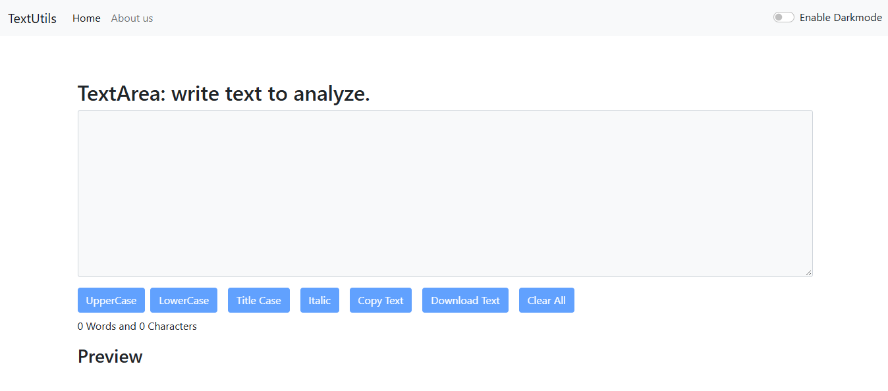

# TextUtils – Text Utility Web App

TextUtils is a React-based web application that helps users perform common text transformations and analyze text easily through a simple and user-friendly interface.

## 🌐 Live Demo

**Try TextUtils here:** [TextUtils Live Website](https://YOUR-NETLIFY-URL.netlify.app)

## ✨ Features

- Convert text to **UPPERCASE**
- Convert text to **lowercase**
- Clear the text area
- Copy text to the clipboard
- Remove extra spaces
- Count words and characters
- Estimate text reading time
- Responsive user interface
- Light and dark mode (if implemented)

## 🛠️ Built With

- React.js
- JavaScript
- HTML5
- CSS3
- Bootstrap 

## 📸 Preview

Add a screenshot of your application to showcase its interface.

```md

```

## 🚀 Getting Started

Follow these instructions to run the project locally.

### Prerequisites

- Node.js and npm installed on your system
- Git installed on your system

### Installation

**1. Clone the repository**

```bash
git clone https://github.com/YOUR-USERNAME/YOUR-REPOSITORY.git
```

**2. Navigate to the project directory**

```bash
cd TextUtils
```

Replace `TextUtils` with your actual project folder name if necessary.

**3. Install dependencies**

```bash
npm install
```

**4. Start the development server**

```bash
npm start
```

Open [http://localhost:3000](http://localhost:3000) in your browser.

## 📦 Build for Production

Create an optimized production build using:

```bash
npm run build
```

The production files will be generated in the `build/` directory.

## ☁️ Deployment

This project is deployed using **Netlify**.

To deploy a Create React App project on Netlify, use these settings:

- **Build command:** `npm run build`
- **Publish directory:** `build`

The live website is available in the Live Demo section above.

## 📁 Project Structure

```text
TextUtils/
├── public/
├── src/
│   ├── components/
│   ├── App.js
│   ├── App.css
│   ├── index.js
│   └── index.css
├── .gitignore
├── package.json
├── package-lock.json
└── README.md
```

The structure may vary depending on your implementation.

## 🎯 Purpose

TextUtils was developed to make everyday text editing and analysis tasks simple, fast, and convenient.

## 👨‍💻 Author

**Your Name**

- GitHub: [Your GitHub Profile](https://github.com/YOUR-USERNAME)
- Live Project: [TextUtils on Netlify](https://YOUR-NETLIFY-URL.netlify.app)

## 📄 License

This project is available for personal and educational use. Add a license file if you wish to distribute it under a specific open-source license.
